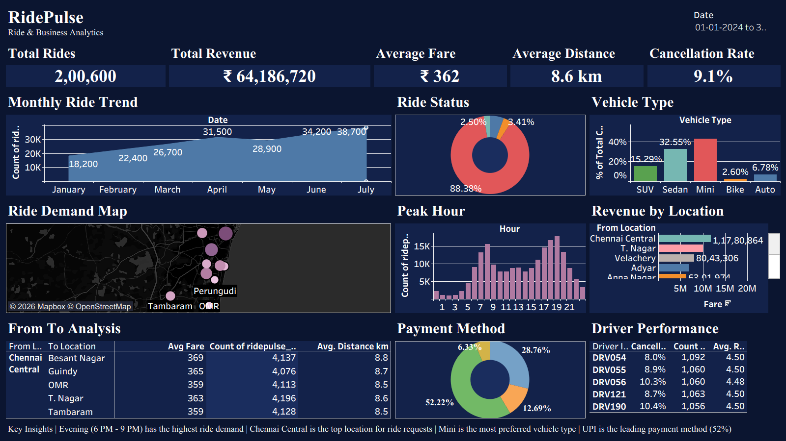

# RidePulse: Ride-Hailing Analytics & Business Intelligence

A comprehensive Big Data Analytics and Business Intelligence project built for ride-hailing demand forecasting, operational efficiency, and revenue optimization using Python and Tableau.

## 📊 Dashboard Preview

## 🚀 Project Overview
RidePulse analyzes large-scale ride-hailing operational data to uncover key insights regarding:
- **Demand Patterns:** Peak hours, high-demand zones, and seasonal trends.
- **Driver Performance & Earnings:** Completion rates, rating distributions, and trip duration metrics.
- **Financial Analytics:** Revenue breakdown by payment method, ride type, and distance.

## 🛠️ Tech Stack
- **Data Generation & Processing:** Python (Pandas, NumPy)
- **Data Visualization & BI:** Tableau (`.twbx` interactive dashboard)
- **Version Control:** Git & GitHub

## 📂 Repository Structure
- `RidePulse.twbx`: Tableau packaged workbook containing the full interactive dashboard.
- `RidePulse_Dashboard.png`: High-resolution preview of the Tableau dashboard.
- `ridepulse_rides (1).csv`: Cleaned dataset containing ride records and operational metrics.
- `generate_ridepulse_data.py`: Python script used to simulate and generate the dataset.

## 💡 Key Insights & Findings
- Identified peak surge hours during morning and evening commutes, helping optimize driver allocation.
- Highlighted the impact of trip distance on overall cancellation rates and pricing strategies.
